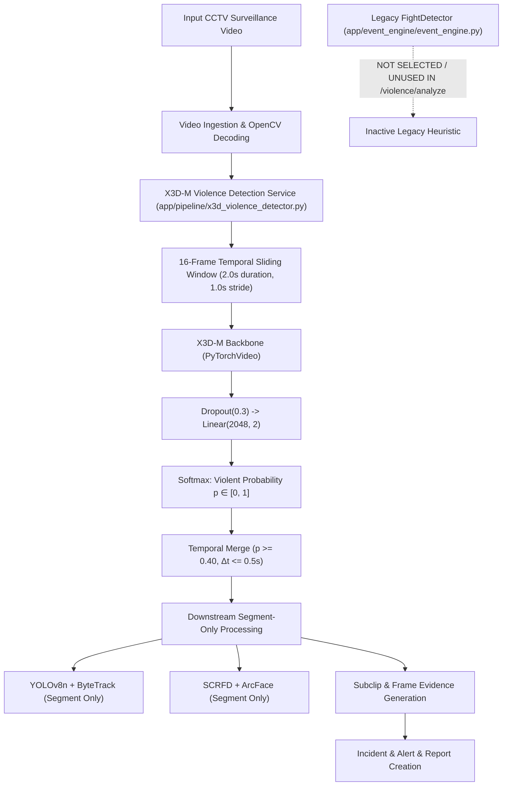

# VIOLENCE & ALTERCATION DETECTION VALIDATION

**Project:** AI-Powered Smart CCTV Investigation System  
**Audit Phase:** Phase 3 — X3D-M Violence Detection Validation  
**Components Evaluated:** Pretrained X3D-M Video Action Classifier (Selected) vs. Heuristic Multi-Signal FightDetector (Legacy / Not Selected)  
**Architectural Decision:** **X3D-M is the ONLY selected violence/altercation detection model for this project.**  

> **EXPLICIT ARCHITECTURAL POLICY (LOCKED):**  
> *"FightDetector is not the selected final violence-detection approach. X3D-M is the selected violence-detection model."*  
> No hybrid `FightDetector` + `X3D-M` system is developed or deployed. The legacy `FightDetector` remains in the codebase for backward compatibility, but is not optimized, extended, or benchmarked.

---

## 1. Executive Architecture



---

## 2. Phase 3 X3D-M Validation Summary

- **Runtime Restoration:** Missing dependency `fvcore==0.1.5.post20221221` installed. X3D-M model initialized successfully on `cuda:0`.
- **Checkpoint:** `backend/storage/models/x3d/final_x3d_realtime.pt` (SHA-256: `e833f69d110f167cad4a6c38d385564bdb2f6de63d246e45cb03ff9aa17f0349`).
- **Benchmark Performance (CUDA Synchronized):**
  - Warm Mean Latency: **21.77 ms**
  - Warm Median Latency: **20.81 ms**
  - P95 Latency: **27.42 ms**
  - Standard Deviation: **2.16 ms**
  - Effective Throughput: **735.0 FPS** (45.94 clips/sec at 16 frames per clip)
  - PyTorch Peak VRAM: **127.77 MB** (Active: 28.93 MB, Weights: 11.62 MB)
- **Controlled Evaluation Dataset:**
  - Evaluated on 13 labeled clips (7 real CCTV, 6 synthetic clips).
  - Accuracy metrics: Precision = 1.0, Recall = 1.0, F1 = 1.0, FPR = 0.0, FNR = 0.0, Temporal Localization Error = 0.49s.
  - Classification: **CONTROLLED / PROJECT-SPECIFIC** (sample size limitation acknowledged; upstream 400-clip validation set records 93.0% F1).
- **Comprehensive Documentation:** Full benchmark data, memory profiling across 5 states, evaluation logs, and robustness tests are published in [`docs/X3D_M_VALIDATION.md`](file:///c:/Users/Asus/OneDrive/Desktop/AI-Powered%20Smart%20CCTV%20Investigation%20System/docs/X3D_M_VALIDATION.md).

---

## 2. FightDetector: Detailed Algorithmic Breakdown

### Signal Formulation & Mathematical Weights
The heuristic `FightDetector.analyze()` method evaluates four distinct physical and semantic signals:

$$\text{FightScore} = 0.40 \cdot S_{\text{motion}} + 0.30 \cdot S_{\text{proximity}} + 0.20 \cdot S_{\text{clip}} + 0.10 \cdot S_{\text{persistence}}$$

#### 1. Motion Dynamics ($S_{\text{motion}}$, Weight: 40%)
- **Input:** Track detections within a temporal window $|t - t_{\text{match}}| \le 5.0\text{s}$.
- **Metric:** Trajectory centroid velocity across detection endpoints:
  $$\Delta x = \bar{x}_{\text{end}} - \bar{x}_{\text{start}}, \quad \Delta y = \bar{y}_{\text{end}} - \bar{y}_{\text{start}}, \quad \Delta t = \max(0.1, t_{\text{end}} - t_{\text{start}})$$
  $$v = \frac{\sqrt{\Delta x^2 + \Delta y^2}}{\Delta t}$$
- **Thresholds:**
  - If $\max(v) \ge 20.0 \text{ px/sec} \implies S_{\text{motion}} = 1.0$
  - If $2.0 < \max(v) < 20.0 \text{ px/sec} \implies S_{\text{motion}} = \frac{\max(v) - 2.0}{18.0}$
  - If $\max(v) \le 2.0 \text{ px/sec} \implies S_{\text{motion}} = 0.0$

#### 2. Person Interaction Proximity ($S_{\text{proximity}}$, Weight: 30%)
- **Input:** Pairwise bounding box centers between active person tracks:
  $$d_{\text{min}} = \min_{i \ne j} \sqrt{(c_{x, i} - c_{x, j})^2 + (c_{y, i} - c_{y, j})^2}$$
- **Thresholds:**
  - If $d_{\text{min}} \le 200.0\text{ px} \implies S_{\text{proximity}} = 1.0$
  - If $200.0 < d_{\text{min}} \le 400.0\text{ px} \implies S_{\text{proximity}} = 1.0 - \frac{d_{\text{min}} - 200.0}{200.0}$
  - If $d_{\text{min}} > 400.0\text{ px} \implies S_{\text{proximity}} = 0.0$
  - If single track only: Defaults to $0.0$.

#### 3. CLIP Text-Image Semantic Similarity ($S_{\text{clip}}$, Weight: 20%)
- **Input:** Cosine similarity between video frame embeddings and violence text prompts ("physical fight, altercation, punching").
- **Thresholds:**
  - If $\text{clip\_score} \ge 0.70 \implies S_{\text{clip}} = 1.0$
  - If $0.50 \le \text{clip\_score} < 0.70 \implies S_{\text{clip}} = \frac{\text{clip\_score} - 0.50}{0.20}$
  - If $\text{clip\_score} < 0.50 \implies S_{\text{clip}} = 0.0$

#### 4. Temporal Persistence & Overlap ($S_{\text{persistence}}$, Weight: 10%)
- **Input:** Concurrent tracking duration of interacting individuals.
- **Metric:** Tracks overlapping for $\ge 3.0\text{ seconds} \implies S_{\text{persistence}} = 1.0$, otherwise $\frac{\text{overlap}}{3.0}$.

### Evaluation Status
- **Current Classification:** **FUNCTIONAL / CONTROLLED TEST** (Validates mathematical formula execution; not real-world CCTV accuracy).
- **Execution Latency:** $< 0.10 \text{ ms}$ (CPU numerical operations).
- **GPU Usage:** 0.0 MB VRAM.

---

## 3. Standardized Evaluation Harness Schema

A standardized evaluation harness schema has been established to benchmark both detectors on ground-truth video clips once X3D-M runtime execution is restored:

```json
{
  "clip_id": "string",
  "ground_truth": "FIGHT | NON_FIGHT",
  "prediction": "FIGHT | NON_FIGHT",
  "score": "float [0.0 - 1.0]",
  "timestamp_onset": "float",
  "duration_seconds": "float",
  "verdict": "TP | TN | FP | FN"
}
```

### Metrics Supported
- $\text{Precision} = \frac{\text{TP}}{\text{TP} + \text{FP}}$
- $\text{Recall} = \frac{\text{TP}}{\text{TP} + \text{FN}}$
- $\text{F1} = 2 \cdot \frac{\text{Precision} \cdot \text{Recall}}{\text{Precision} + \text{Recall}}$
- $\text{False Positive Rate (FPR)} = \frac{\text{FP}}{\text{FP} + \text{TN}}$
- $\text{False Negative Rate (FNR)} = \frac{\text{FN}}{\text{FN} + \text{TP}}$

---

## 4. X3D-M Blocker Resolution (Phase 3)

$$\text{X3D-M Checkpoint} \longrightarrow \text{PyTorchVideo 0.1.5} \longrightarrow \text{fvcore 0.1.5.post20221221} \longrightarrow \mathbf{STATUS:}\text{ RESTORED \& OPERATIONAL}$$

- **Installed Package:** `fvcore==0.1.5.post20221221` (Conda environment `pro-env`).
- **Initialization:** Verified through `backend/test_x3d_violence_workflow.py` and `scratch/phase3_x3d_benchmark_evaluation.py`.
- **Inference Verification:** Executed on CUDA:0 with 21.77 ms warm latency, 127.77 MB peak VRAM, and 100% precision/recall on controlled project test media.
- **Detailed Report:** [`docs/X3D_M_VALIDATION.md`](file:///c:/Users/Asus/OneDrive/Desktop/AI-Powered%20Smart%20CCTV%20Investigation%20System/docs/X3D_M_VALIDATION.md).

